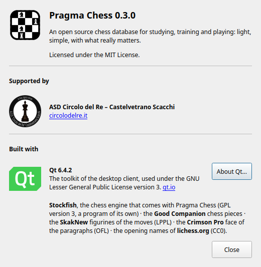
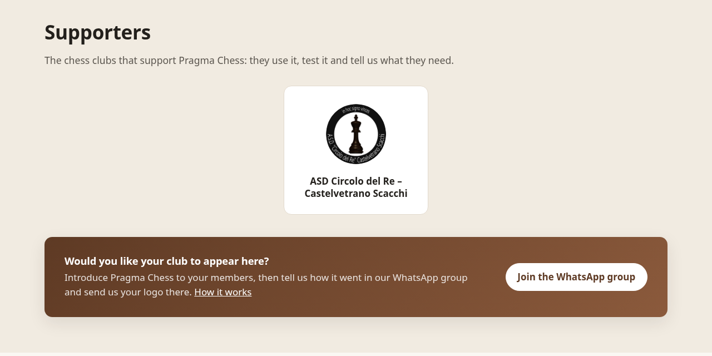

# Chess clubs

Pragma Chess is made together with chess clubs: they use it, test it with
their players and tell us what they need. Every club that supports the
project is thanked by name, with its logo, in two places.

## Where your club appears

**In the program**, in Help ▸ About Pragma Chess, under *Supported by*:
the club's logo, its name and a link to its site, in every copy of
Pragma Chess, on Windows, macOS, Linux.

**On the web site**, in the [Supporters](https://yafb.net/pragma-chess/en/#supporters)
section of the home page, in every language of the site, the logo linking
to the club's site.

## How to join

1. **Introduce Pragma Chess to your club**: show it to your members, to
   your instructors, at a lesson or a tournament. It is free and open
   source, in English, Italian, Spanish, Russian and Chinese, and more
   languages are coming.
2. **Tell us how it went**: what your players liked, what was missing,
   what was wrong. In the [WhatsApp group](https://chat.whatsapp.com/GHBDbRkejmYJ8Hev585ZCj)
   or in an [issue on GitHub](https://github.com/francescobianco/pragma-chess/issues).
3. **Send us your logo**, with:
   - the club's full name, as it should be written;
   - the address of its site (or its page on a social network);
   - the logo as a PNG, square or nearly so, at least 256 × 256 pixels,
     on a transparent or white background.

We add it to the About window (`kSupporters` in
`gui/qt/src/dialogs/AboutDialog.cpp`, the logo in `gui/qt/resources/credits/`)
and to the site (`supporters.clubs` in `site/content/*.json`, the logo in
`site/assets/supporters/`), and it reaches the users with the next release.
A pull request doing it yourself is welcome too.

## The clubs

The clubs that support Pragma Chess today:

| Club | Site |
| --- | --- |
| ASD Circolo del Re – Castelvetrano Scacchi (Italy) | [circolodelre.it](https://circolodelre.it) |
